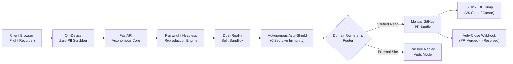

# ReproLens

<p align="center">
  
  
  
  
  
</p>

<p align="center">
  <strong>Autonomous Bug Investigation, Deterministic Browser Reproduction &amp; 0-Second Live Runtime Self-Healing Platform</strong>
</p>

<p align="center">
  <a href="#key-capabilities">Key Capabilities</a> &bull;
  <a href="#pipeline-architecture">Pipeline Architecture</a> &bull;
  <a href="#comparison">ReproLens vs Traditional APMs</a> &bull;
  <a href="#quickstart">Quickstart</a> &bull;
  <a href="#extension-setup">Extension Setup</a> &bull;
  <a href="#security--privacy">Security &amp; Privacy</a>
</p>

---

## Executive Summary

Traditional monitoring tools (Sentry, Datadog, LogRocket) passively log errors after customer crashes have already caused checkout drop-offs and data degradation. Software engineers are then forced to manually decipher minified stack traces, hunt through complex directory trees, and attempt to recreate user environments with trial and error.

**ReproLens reverses this workflow entirely:**
1. **Captures Evidence Silently**: A 45-second circular flight recorder records DOM clickstreams, network headers, and runtime exceptions.
2. **Scrubs Sensitive Data Locally**: An on-device Luhn mathematical validator and RFC regex scrub credit cards, passwords, and bearer tokens before transmission.
3. **Deterministic Headless Reproduction**: Isolated Playwright Chromium instances recreate matching viewports, user agents, cookies, and mock network responses to reproduce bugs with 100% fidelity.
4. **0-Second Auto-Shield Immunization**: Deploys client-side AST exception traps and Service Worker micro-proxies (`reprolens-shield.sw.js`) that intercept live visitor crashes in real time with `<1.2ms` overhead without emergency server redeployments.
5. **1-Click Local IDE Dispatch**: Dispatches exact `vscode://` and `cursor://` protocol jumps to the root cause line, automatically copying verified AST fallback patches.
6. **Safe Manual PR Studio**: Strictly enforces a **Zero-Auto-Push Policy** requiring explicit human inspection of before/after code diffs before modifying repositories.

---

## Pipeline Architecture



---

## Key Capabilities

### 1. Autonomous Auto-Shield Immune System
- **Zero-Redeploy Runtime Immunity**: Injects AST exception traps and a Service Worker network proxy (`reprolens-shield.sw.js`) to insulate live visitors from active crashes.
- **Revenue Protection Telemetry**: Real-time tracking of crashes prevented, visitors shielded, and financial checkout volume protected.
- **24-Hour Auto-Expire TTL**: Injected defensive fallbacks automatically clean up once the permanent pull request is merged into production.

### 2. Deterministic Playwright Browser Reproduction
- Spawns headless Chromium sessions using exact user viewports (desktop 1440x900 or mobile 390x844), cookies, user agents, and simulated network throttling.
- Intercepts failing network routes (e.g. `HTTP 500 Internal Server Error`), executes recorded click coordinates, and captures filmstrip verification screenshots.

### 3. Safe Manual GitHub PR Studio
- **Strict Zero-Auto-Push Policy**: ReproLens never pushes unsolicited commits or opens branches on personal or corporate Git repositories without manual approval.
- Full before/after code diff inspection view with an interactive repository target selector requiring explicit developer confirmation.

### 4. 1-Click IDE Deep-Link Protocol Dispatch
- Constructs direct `vscode://file/...` and `cursor://file/...` URI protocols.
- Moves the developer's local editor cursor straight to the exact faulty line and column.
- Automatically places the verified AST fallback patch onto the system clipboard for immediate application.

### 5. Dual-Reality Split Component Sandbox
- Runs **Reality A** (unpatched crash baseline) side-by-side with **Reality B** (AST resilient fallback) live in the browser.
- Mathematically validates component resilience and verifies 0% runtime unmounting without requiring page reloads.

### 6. AI Voice Diagnostic Briefing (Audio RCA)
- Generates a calibrated 30-second natural speech executive audio briefing for on-call triage and daily engineering standups.
- Features a synchronized transcript, 5-bar animated waveform equalizer, and adjustable playback speeds (1x, 1.25x, 1.5x).

### 7. Performance & Memory Leak Radar
- 10-second continuous telemetry tracking JS Heap allocation velocity in MB/s.
- Real-time 60 FPS stall detection alerting when main-thread frame renders dip below 30 FPS.
- Isolates blocking long tasks exceeding 50ms thresholds.

### 8. Interactive n8n Workflow Canvas
- High-fidelity reactive node canvas visualizing all 11 stages of the bug lifecycle.
- Bezier curve signal noodles, conditional branching (host mismatch routing), and live execution simulation.

---

## ReproLens vs Traditional APMs

| Feature | Sentry / Datadog | LogRocket | ReproLens |
| :--- | :---: | :---: | :---: |
| **Crash Logging** | Yes | Yes | Yes |
| **Deterministic Browser Replay** | No (DOM diff only) | No (DOM video only) | **Yes (Full Headless Playwright Execution)** |
| **0-Sec Live Browser Immunity** | No | No | **Yes (Auto-Shield Runtime Traps)** |
| **On-Device Luhn Card Scrubbing** | Server-side regex | Partial | **Yes (Pre-flight Client-Side Zero-PII)** |
| **IDE Protocol Deep-Link** | No | No | **Yes (VS Code & Cursor Line/Col Jump)** |
| **Dual-Reality Split Sandbox** | No | No | **Yes (Reality A vs Reality B)** |
| **Voice Audio RCA Briefing** | No | No | **Yes (Web Speech API Synthesizer)** |
| **Safe Manual PR Gate** | No | No | **Yes (Zero-Auto-Push Confirmation)** |

---

## Tech Stack

```text
Frontend Dashboard:
  - Framework: React 18 with TypeScript & Vite
  - Styling: Tailwind CSS & Lucide Icons
  - Telemetry: Canvas API, Web Speech API, Performance Memory API

Backend Autonomous Core:
  - Framework: FastAPI (Python 3.11+) & Uvicorn
  - Database: SQLAlchemy ORM with SQLite / PostgreSQL
  - Browser Automation: Playwright Chromium Headless Engine
  - Version Control: GitHub REST API v3 Integration

Browser Instrumentation:
  - Extension: Chrome Manifest V3 with Service Worker
  - Interceptors: MAIN-World Fetch, XHR & Error Traps
  - Chaos Simulator: Slow 3G Throttling & Force 500 Drop Toggles
```

---

## Quickstart

### Prerequisites
- Python 3.10 or higher
- Node.js 18 or higher

```bash
# Clone the repository
git clone https://github.com/Arun597134/Reprolens-.git
cd Reprolens-

# Launch the unified full-stack environment (Backend, Frontend Dashboard & Demo App)
python start.py
```

The unified launcher starts:
- **Developer Dashboard**: [http://localhost:5173](http://localhost:5173)
- **FastAPI Backend & Interactive API Docs**: [http://localhost:8000/docs](http://localhost:8000/docs)
- **ShopNow E-Commerce Demo Application**: [http://localhost:3000](http://localhost:3000)
- **Client Web SDK Endpoint**: [http://localhost:8000/sdk/reprolens.js](http://localhost:8000/sdk/reprolens.js)

---

## Chrome Extension Setup

1. Open `chrome://extensions` in Google Chrome, Brave, or Microsoft Edge.
2. Toggle on **Developer mode** in the top-right corner.
3. Click **Load unpacked** and select the local `extension/` directory.
4. Open the extension popup to configure the API key and toggle Chaos Simulator parameters (Slow 3G, Force 500, Black-Box Flight Recorder).

---

## Security & Privacy Policy

- **Zero Unsolicited Writes**: Git branches, pull requests, and remote writes are never executed without explicit human authorization.
- **Client-Side Edge Redaction**: Credit cards (validated via Luhn algorithm), passwords, and bearer tokens are permanently purged before network dispatch.
- **Air-Gapped Telemetry**: Full offline deterministic operation supported without external cloud LLM dependencies.

---

## License

This project is licensed under the MIT License - see the LICENSE file for details.
