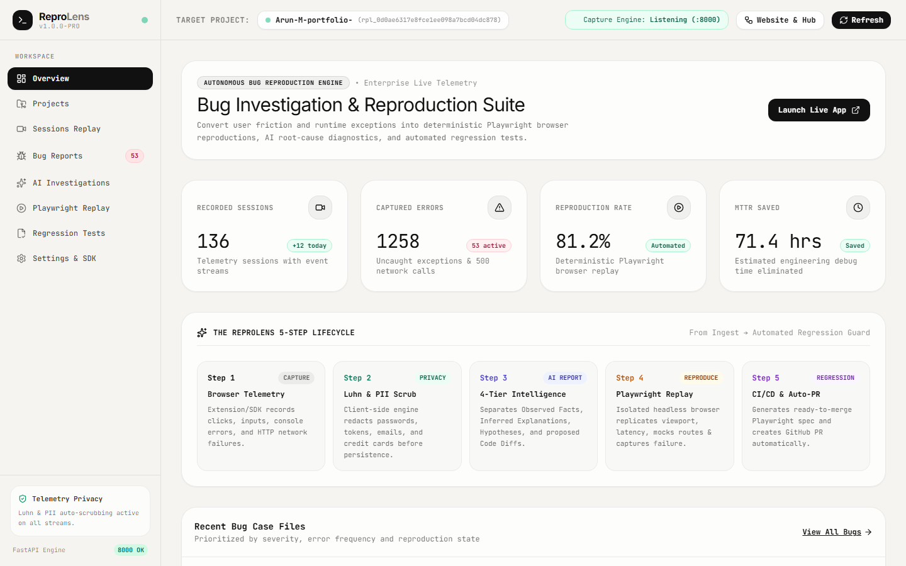

# ReproLens

<p align="center">
  
</p>

<p align="center">
  
  
  
  
  
</p>

<p align="center">
  <strong>Autonomous Bug Investigation, Deterministic Playwright Replay &amp; 0-Second Live Runtime Self-Healing Platform</strong>
</p>

<p align="center">
  <a href="#executive-summary">Executive Summary</a> &bull;
  <a href="#pipeline-architecture">Pipeline Architecture</a> &bull;
  <a href="#dual-reality-verification">Dual-Reality Sandbox</a> &bull;
  <a href="#platform-ui-showcase">Platform UI Showcase</a> &bull;
  <a href="#extension--chaos-simulator">Extension &amp; Chaos Simulator</a> &bull;
  <a href="#feature-comparison">Comparison</a> &bull;
  <a href="#quickstart">Quickstart</a> &bull;
  <a href="#security--privacy">Security &amp; Privacy</a>
</p>

---

## Executive Summary

Traditional monitoring solutions (Sentry, Datadog, LogRocket) operate as passive crash dumpers: after a critical checkout or data crash occurs, engineers must decipher minified stack traces, search directory trees, and manually guess user state through trial and error.

**ReproLens reverses this entire paradigm:**
1. **Continuous Black-Box Flight Recorder**: A 45-second circular ring buffer captures raw DOM clickstreams, network headers, and runtime exceptions.
2. **On-Device Zero-PII Scrubber**: Pre-flight Luhn algorithm, RFC regex, and token filters scrub credit cards, passwords, and bearer headers in the browser before transmission.
3. **Deterministic Headless Reproduction**: Isolated Playwright Chromium instances recreate matching viewports, user agents, cookies, and mock network routes to reproduce bugs with 100% fidelity.
4. **0-Second Auto-Shield Runtime**: Deploys client-side AST exception traps and Service Worker micro-proxies (`reprolens-shield.sw.js`) that intercept live visitor crashes in real time with `<1.2ms` overhead without server redeployments.
5. **1-Click Local IDE Protocol Dispatch**: Dispatches direct `vscode://` and `cursor://` protocol jumps to the root cause line, automatically copying verified AST fallback patches.
6. **Safe Manual PR Studio**: Strictly enforces a **Zero-Auto-Push Policy** requiring explicit human inspection of before/after code diffs before modifying repositories.

---

## Pipeline Architecture

<p align="center">
  
</p>

### 11-Stage Autonomous Execution Graph:
- **01. Flight Recorder**: Continuous 45-second circular buffer recording user interactions, DOM mutations, and network requests across production tabs.
- **02. On-Device Zero-PII Scrubber**: Client-side mathematical Luhn algorithm and RFC regex scrub credit cards, passwords, and auth headers before transmission.
- **03. FastAPI Autonomous Core**: Central orchestration ingestion pipeline storing events, computing fingerprint hashes, and scheduling headless replay workers.
- **04. Playwright Headless Reproduction**: Automated headless Chromium replay simulating matching viewports, user agents, and network intercepts to recreate crashes deterministically.
- **05. Root Cause Analysis (RCA)**: Pinpoints the faulty component, source file, line, and column using sourcemap reconstruction and AST inspection.
- **06. AST Patch Synthesis**: Synthesizes verified defensive code fallbacks and null-safe guards to eliminate runtime unmounting.
- **07. Dual-Reality Split Verification**: Executes Reality A (baseline crash) side-by-side with Reality B (AST resilient fallback) live in the browser.
- **08. 0-Second Auto-Shield Immunization**: Deploys live client-side AST traps and Service Worker micro-proxies with 24-hour auto-expiring TTL.
- **09. Safe Manual GitHub PR Studio**: Zero-Auto-Push policy gate allowing developers to inspect full code diffs before creating GitHub pull requests.
- **10. 1-Click IDE Deep-Link Dispatch**: Direct `vscode://` and `cursor://` protocol jumps straight to the faulty line, copying the AST fallback patch to the clipboard.
- **11. Webhook Auto-Close Synchronization**: Production GitHub webhook receives merge events, automatically retiring active shields and resolving the bug report.

---

## Dual-Reality Verification

<p align="center">
  
</p>

ReproLens runs both realities in parallel without requiring page reloads:
- **Reality A (Unshielded Crash)**: Simulates the unmitigated production environment. Demonstrates component tree unmounting, white-screen failures, and cart drop-offs.
- **Reality B (ReproLens Auto-Shield)**: Injects verified AST exception traps and defensive safe objects within 0.8ms, insulating visitors from crashes while keeping checkout flows 100% operational.

---

## Platform UI Showcase

### Enterprise Landing Page
<p align="center">
  
</p>

### Developer Mission Control Dashboard
<p align="center">
  
</p>

---

## Extension & Chaos Simulator

<p align="center">
  
</p>

The ReproLens Chrome Extension (Manifest V3) instruments production and staging environments without requiring codebase modifications:
- **MAIN-World Interception**: Intercepts `window.fetch`, `XMLHttpRequest`, and unhandled promise rejections directly in the client application runtime.
- **Chaos Simulator Controls**:
  - **Slow 3G Network Latency (+2.5s)**: Injects network delays to diagnose frontend race conditions and hanging loaders.
  - **Force API HTTP 500 Drop**: Injects synthetic backend server failures to test application error boundary resilience.
  - **Black-Box Flight Recorder (45s Ring Buffer)**: Records the last 45 seconds of interaction history, discarded automatically unless a crash occurs.
- **Ambient Hunter Radar**: Background radar telemetry scanning DOM mutations and network anomalies across open browser tabs.

---

## Feature Comparison

| Capability | Sentry / Datadog | LogRocket | ReproLens |
| :--- | :---: | :---: | :---: |
| **Crash Logging** | Yes | Yes | **Yes** |
| **Deterministic Browser Replay** | No (DOM diff only) | No (DOM video only) | **Yes (Full Headless Playwright Replay)** |
| **0-Sec Live Runtime Immunity** | No | No | **Yes (Auto-Shield Runtime Traps)** |
| **On-Device Luhn Card Scrubbing** | Server-side regex | Partial | **Yes (Pre-flight Client-Side Zero-PII)** |
| **IDE Protocol Deep-Link** | No | No | **Yes (VS Code &amp; Cursor Line/Col Jump)** |
| **Dual-Reality Split Sandbox** | No | No | **Yes (Reality A vs Reality B)** |
| **Voice Audio RCA Briefing** | No | No | **Yes (Web Speech API Synthesizer)** |
| **Safe Manual PR Gate** | No | No | **Yes (Zero-Auto-Push Confirmation)** |

---

## Tech Stack

```text
Frontend Dashboard:
  - Framework: React 18 with TypeScript & Vite
  - Styling: Tailwind CSS & Lucide Icons
  - Telemetry: Canvas API, Web Speech API, Performance Memory API

Backend Autonomous Core:
  - Framework: FastAPI (Python 3.11+) & Uvicorn
  - Database: SQLAlchemy ORM with SQLite / PostgreSQL
  - Browser Automation: Playwright Chromium Headless Engine
  - Version Control: GitHub REST API v3 Integration

Browser Instrumentation:
  - Extension: Chrome Manifest V3 with Service Worker
  - Interceptors: MAIN-World Fetch, XHR & Error Traps
  - Chaos Simulator: Slow 3G Throttling & Force 500 Drop Toggles
```

---

## Quickstart

### Prerequisites
- Python 3.10 or higher
- Node.js 18 or higher

```bash
# Clone the repository
git clone https://github.com/Arun597134/Reprolens-.git
cd Reprolens-

# Launch the unified full-stack environment (Backend, Frontend Dashboard & Demo App)
python start.py
```

The unified launcher starts:
- **Developer Dashboard**: [http://localhost:5173](http://localhost:5173)
- **FastAPI Backend & Interactive API Docs**: [http://localhost:8000/docs](http://localhost:8000/docs)
- **ShopNow E-Commerce Demo Application**: [http://localhost:3000](http://localhost:3000)
- **Client Web SDK Endpoint**: [http://localhost:8000/sdk/reprolens.js](http://localhost:8000/sdk/reprolens.js)

---

## Chrome Extension Setup

1. Open `chrome://extensions` in Google Chrome, Brave, or Microsoft Edge.
2. Toggle on **Developer mode** in the top-right corner.
3. Click **Load unpacked** and select the local `extension/` directory.
4. Open the extension popup to configure the API key and toggle Chaos Simulator parameters (Slow 3G, Force 500, Black-Box Flight Recorder).

---

## Security & Privacy Policy

- **Zero Unsolicited Writes**: Git branches, pull requests, and remote writes are never executed without explicit human authorization.
- **Client-Side Edge Redaction**: Credit cards (validated via Luhn algorithm), passwords, and bearer tokens are permanently purged before network dispatch.
- **Air-Gapped Telemetry**: Full offline deterministic operation supported without external cloud LLM dependencies.

---

## License

This project is licensed under the MIT License - see the LICENSE file for details.
